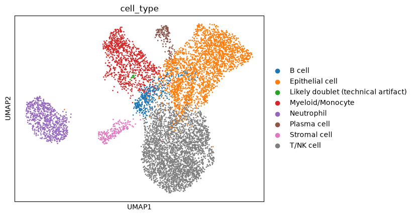

# Single Cell RNA-seq Analysis: Endometrial Cancer (GSE203612)

[](https://github.com/MaryOlufunmilola/scRNA-seq-analysis/actions/workflows/ci.yml)

A single cell RNA-seq pipeline run on three public human uterine corpus endometrial
carcinoma (UCEC) tumors from
[GSE203612](https://www.ncbi.nlm.nih.gov/geo/query/acc.cgi?acc=GSE203612)
(Barkley et al., *Nature Genetics* 2022). It covers QC and doublet detection,
integration across patients, clustering, annotation, and a neural network classifier
that is tested on a patient it was not trained on. Two optional steps, both
exploratory, export a signature matrix for bulk deconvolution and infer cell to cell
communication.



The data are small: three patients, six libraries, and 8,000 cells after QC. That is
enough to build and test the pipeline and describe these tumors, not to make general
claims about endometrial cancer.

## Quick start

```bash
git clone https://github.com/MaryOlufunmilola/scRNA-seq-analysis.git
cd scRNA-seq-analysis
pip install -r requirements.txt          # or requirements-lock.txt to reproduce exactly

bash run_pipeline.sh                      # tests + steps 1 to 4, logs in logs/
bash run_pipeline.sh --all                # also steps 5 and 6
```

Step 1 downloads the GEO archive on the first run and reuses it afterwards. To look
through the outputs, install Jupyter (`pip install jupyterlab`) and open
`notebooks/analysis.ipynb`.

To check the pipeline without downloading anything, run the toy example:

```bash
bash example/run_example.sh
```

It generates a small synthetic dataset with five planted cell types, runs steps 1 to 4,
and fails if QC misses the planted empty or damaged barcodes, if any cell type is
recovered below 90%, or if accuracy on a held out patient falls below 0.85. CI runs it
on every push. The same mechanism works for your own data: name the files as in the
input row below and run `python scripts/preprocess.py --raw-dir path/to/folder`.

## Results

After QC there are 3,073 T/NK cells, 2,514 epithelial cells, 960 myeloid/monocyte
cells, 700 neutrophils, 395 B cells, 192 stromal cells, and 154 plasma cells, plus one
12-cell cluster flagged as doublets by a test at the cluster level.

### Annotation evidence

Each of the 16 Leiden clusters is labeled from a panel of 31 marker genes for 9 cell
types (all 31 are present in the data). Evidence for each label is saved in `results/`:

| Check | What it shows | Result |
|---|---|---|
| Score margin (`marker_annotation_confidence.csv`) | How far the winning cell type scores above the runner up | 0.68 to 3.0 for the immune, stromal, and main epithelial clusters |
| Threshold sensitivity (`min_margin_sensitivity.csv`) | Whether labels change as the margin threshold moves from 0.05 to 0.30 | No label changes except the 12-cell doublet cluster |
| Per cell agreement (`cluster_annotation_concordance.csv`) | Fraction of cells that get the cluster's label when scored one at a time | 41% to 88% in those clusters; the rest split between ambiguous and another type, which is common with sparse counts per cell |
| CellTypist (`annotation_cross_check_immune_only.csv`) | An independent reference model, run on immune clusters only | Agrees on 8 of 10 |
| Doublet test (`cluster_doublet_enrichment.csv`) | Clusters with higher Scrublet scores than the rest | One cluster (12 cells) flagged and excluded from the classifier |

The two CellTypist disagreements are the doublet cluster and a cluster CellTypist calls
classical monocytes; the marker panel scores it clearly as neutrophils (margin 2.7).
The classifier's top epithelial gene is WFDC2 (HE4), a known endometrial cancer marker
that is not in the panel.

The weakest labels are four epithelial clusters (2, 5, 6, and 15; 1,336 of the 2,514
epithelial cells). Fewer than 10% of their cells express the epithelial markers, and
under a quarter get the epithelial label when scored one at a time. They are labeled
epithelial mainly because every other cell type scores below average there. They may
be tumor cells with low marker detection or lower quality cells; this analysis does not
separate the two, so counts for epithelial cells should be read with that in mind.

### Label transfer across patients

Training the classifier on two patients and predicting the third:

| Held out patient | Accuracy | Macro F1 |
|---|---|---|
| NYU_UCEC1 | 0.90 | 0.79 |
| NYU_UCEC2 | 0.95 | 0.78 |
| NYU_UCEC3 | 0.97 | 0.94 |

A random split of cells gives 0.97 accuracy, which looks better than it is. Holding out
whole patients showed that the macro F1 gap comes almost entirely from plasma cells:
93% of them come from one patient, so when that patient is held out the model has
barely seen any. Without plasma cells, macro F1 is 0.91 to 0.94.

What this test does and does not show: the labels for every cell, including the held
out patient's, come from one joint analysis of all three patients (Harmony
integration, clustering, and marker annotation), and the genes the classifier uses were
selected on all cells. Only the PCA and the classifier are fit without the held out
patient. So the test measures whether the classifier can reproduce the joint
analysis's labels on a patient it was not trained on. It does not validate the
annotation pipeline itself, and with three patients from one study it is not
independent validation. Doing that would need a separate dataset annotated on its own.

Clustering is moderately stable: mean ARI 0.74 when the clustering is rerun on
subsamples.

### Exploratory steps

Steps 5 and 6 run only with `--all`, and I treat their outputs as exploratory. The
signature matrix averages each cell type over three patients, so it reflects these
tumors rather than endometrial cancer in general; check it against a larger reference
before using it to deconvolve bulk data. The cell to cell communication p-values
permute cells, not patients, so they overstate confidence, and with three patients a
ligand and receptor pair seen in one tumor can dominate. Use them to pick hypotheses to
test, not as findings.

## Pipeline

| Step | Script | What it does |
|---|---|---|
| 1 | `preprocess.py` | Download GEO data and verify checksums; QC (at least 100 genes, at most 15% mitochondrial); Scrublet doublets per library; normalization; HVG selection |
| 2 | `clustering.py` | PCA, Harmony integration across patients, Leiden clustering, UMAP, subsampling stability (ARI), composition tables |
| 3 | `annotate.py` | Annotation from a marker panel (epithelial, stromal, endothelial, immune), with CellTypist as a cross check on immune cells and a doublet test at the cluster level |
| 4 | `machine_learning.py` | PyTorch classifier on PCA fitted to training cells only; leave one patient out evaluation; Integrated Gradients gene attributions |
| 5 | `export_signature_matrix.py` | Exploratory: cell type reference on a linear scale for bulk deconvolution (e.g., TCGA-UCEC) |
| 6 | `cell_communication.py` | Exploratory: ligand and receptor inference (liana-py, CellChat method) on all genes |

## Inputs and outputs

Input is the three GSE203612 tumors (downloaded and checked against pinned checksums
by step 1), or your own libraries with `--raw-dir`. Each library is a pair of files:
`<sample>_<libN>_gene_expression.mtx.gz` (Matrix Market counts, genes × cells) and
`<sample>_<libN>_genes.tsv.gz` (Ensembl ID, gene symbol).

| Output | Files |
|---|---|
| Annotated cells | `data/annotated_data.h5ad` (raw counts in `layers["counts"]`, `obs["cell_type"]`, `obs["leiden_clusters"]`, UMAP) |
| QC summary | `results/qc_cell_counts_by_stage.csv`, `results/figures/qc_*.png` |
| Cluster labels and confidence | `results/marker_annotation_confidence.csv`, `results/figures/umap_annotation.png` |
| Classifier | `results/leave_one_patient_out.csv`, `models/cell_type_predictor.pth` |
| Run record | `results/preprocess_params.json`, `results/run_metadata.json` (settings, checksums, package versions) |
| With `--all` (exploratory) | `results/cell_type_signature_matrix.csv`, `results/cell_communication_results.csv` |

## Run time

On a MacBook Pro (CPU only), steps 1 to 4 take about a minute and peak at 1.5 GB of
memory, plus about 25 seconds for the test suite. That excludes the first GEO download.
The toy example takes about 40 seconds. `run_pipeline.sh` writes each step's time and
peak memory to `logs/timing.tsv`. Inputs are about 15 MB of raw counts for the six
libraries.

## Tests

88 unit tests on synthetic data, with Scrublet, CellTypist, and Harmony stubbed out.
They cover guards against data leakage, Integrated Gradients properties, averaging the
signature matrix on a linear scale, and safe archive extraction. CI runs `pytest` and
`ruff` on Python 3.10 and 3.11, plus the toy example. The GEO archive and CellTypist
model have pinned SHA-256 checksums, every run records its parameters and package
versions, and `requirements-lock.txt` has exact versions.

```bash
pip install -r requirements-dev.txt
pytest                       # pytest -m "not slow" for a quick run
ruff check .
```

## Limitations

Three patients from one study, with several cell populations concentrated in one. The
classifier results are label transfer within this dataset, not independent validation
of the annotation, and the signature matrix and cell to cell communication results are
exploratory (see Results). T and NK cells, and fibroblasts and pericytes, cannot be
separated at this depth, so they are reported as "T/NK cell" and "Stromal cell". Four
epithelial clusters have weak marker support. There is no ambient RNA correction, and
malignant and normal epithelium are not distinguished. The next step is to apply the
pipeline to a larger, independently annotated endometrial dataset.

## Data source

Barkley D, Moncada R, Pour M, et al. "Cancer cell states recur across tumor types and
form specific interactions with the tumor microenvironment." *Nature Genetics* 2022.
Samples GSM6177620 to GSM6177622 (NYU_UCEC1, NYU_UCEC2, NYU_UCEC3).

## License

MIT; see `LICENSE`.
